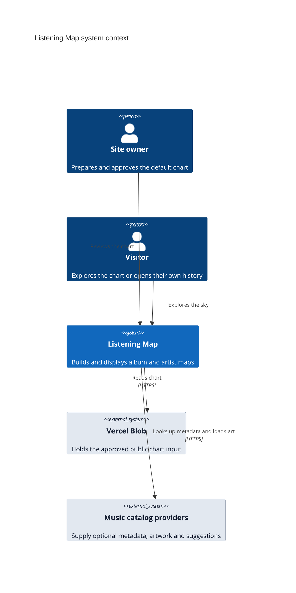
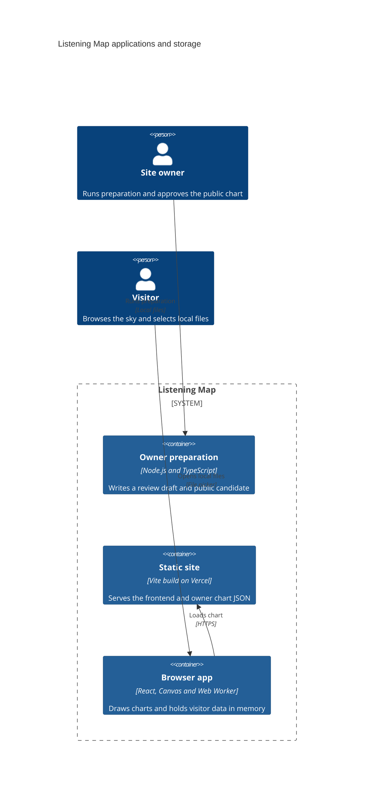
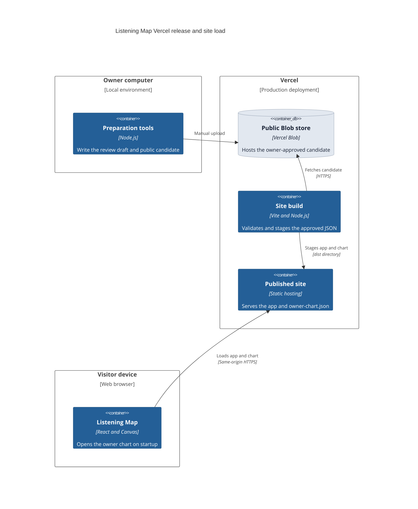
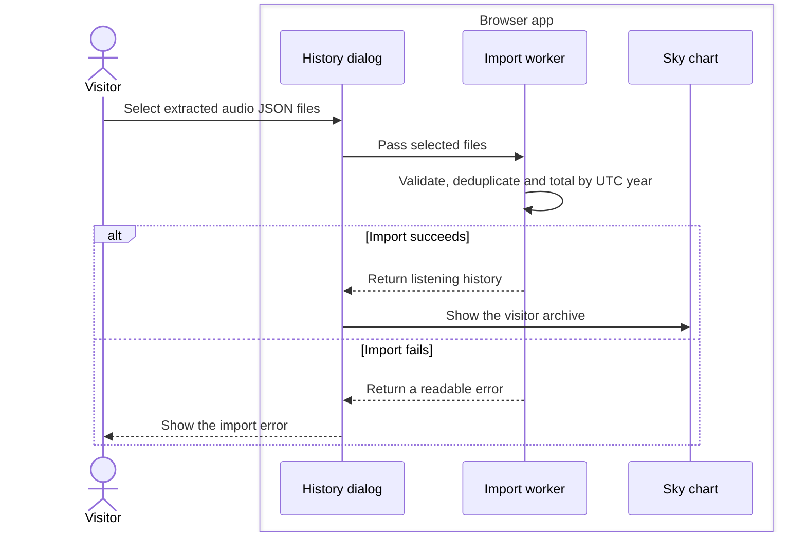
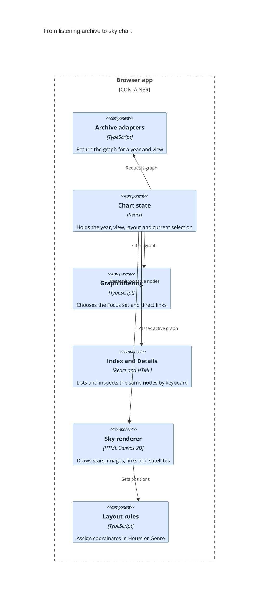

# Spaceify

Spaceify turns Spotify Extended Streaming History into an interactive star chart. Explore your albums and artists by listening time or genre, see how your listening changed year by year, and zoom into an album to see its tracks as satellites.

The hosted app opens with the owner’s published map. To see your own, choose **History** and select the extracted `Streaming_History_Audio_*.json` files from your Spotify export. Your import stays in your browser and clears on reload.

## Listening Map in context



## Where the code runs



## How the owner chart reaches Vercel



## What happens when a visitor imports history



## How the app draws the sky



## Run locally

Use Node.js 22.13+ on the 22.x line or Node.js 24+. Run the commands below and open the local URL Vite prints.

```sh
npm ci
npm run dev
```

[Architecture walkthrough](docs/ARCHITECTURE.md) · [Maintainer guide](docs/MAINTAINER_GUIDE.md)
